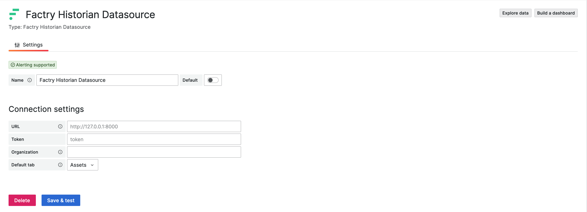

# Factry Historian Datasource


> ⚠️ **Minimum supported Factry Historian version: v7.3.0.**
> Compatibility code for older Historian versions has been removed. Please upgrade your Historian before installing or updating this plugin.

The Factry Historian datasource plugin for [Grafana](https://grafana.com) allows you to seamlessly visualize time-series and event data collected and stored by [Factry Historian](https://www.factry.io/historian). Connect your Historian instance and start building dashboards with your industrial data in minutes.

> ⚡ New to Factry Historian?
> If you don’t have Factry Historian running yet, no problem! You can quickly trial the software using a [ready-to-run docker-compose setup](https://github.com/factrylabs/historian). It spins up a local Historian instance with a 2-hour runtime limit, perfect for testing the Grafana datasource and exploring your data without installing anything permanently.

⚠️ _Warning:_ Before upgrading this datasource, make sure to read the [changelog](https://docs.factry.io/changelog/factry-historian-datasource-for-grafana) to understand any breaking changes or required migration steps. For every new release we will support at least the two latest major versions of Grafana.

## Features

- Query historical data using the asset tree defined in Factry Historian
- Query historical data using measurements from Factry Historian
- Autoload units of Measurement, Y-axis scaling and HI/LO boundaries
- Query Events from Factry Historian (e.g. batches, CIP cycles)
- Annotate trends with Event data from Factry Historian
- Use assets, measurements and events from Factry Historian as variables to build dynamic dashboards

## Typical use cases

- Browsing your asset structure (e.g. ISA88/ISA95 equipment model)
- Trending time-series data, while auto-configuring units of measurement
- Overlaying of events (e.g. golden batch analysis)
- Ad-hoc overlaying of time-series data on top of events

## Getting Started

### 1. Install Factry Historian

If you don't have a licensed version of Factry Historian, you can try it for yourself with a trial. Go to <https://github.com/factrylabs/historian> to download your copy and run it locally.

### 2. Install the Factry Historian datasource plugin

Install the datasource in Grafana by navigating to `Home > Administration > Plugins and data > Plugins` and searching for "Factry" there.

Alternatively, you can install it using the grafana-cli or by cloning the repository directly into the Grafana plugins directory.

```bash
grafana-cli plugins install factry-historian-datasource
```

### 3. Configure the datasource

Create a new instance of the data source from the Grafana Data Sources administration page and configure the necessary settings.



- URL: The URL of the Factry Historian API (e.g. <http://localhost:8000> or <http://historian:8000> when running in Docker)
- Token: The API token to authenticate with the Factry Historian API
- Organization: The UUID of the organization to query data from
- Default tab: The default tab to show when opening the query editor
- Display names: An optional default series display name for the Assets and the Measurements tab, see [Display names](#display-names)

#### Display names

By default a series of the Assets tab is named after its asset path and property, and a series of the Measurements tab after its measurement. Both append their tags (such as `status`) in braces. To use one naming convention across all dashboards, set a template per tab under Display names. It replaces the built-in name for every query of that tab, also in panels saved before the template was set.

A template is text with `${__field.labels["<label>"]}` (or `${__field.labels.<label>}`) placeholders, for example `${__field.labels["AssetProperty"]}` to show only the property name. Labels:

- Assets: `AssetPath`, `AssetName`, `AssetProperty`, `MeasurementName`, `DatabaseName`, `Description`
- Measurements: `MeasurementName`, `DatabaseName`, `Description`
- Both: `status` and any tag the query groups by. A label a series does not have renders empty.

Leave a template empty to keep the built-in name. A Display name set on a panel still takes precedence. While a template is set, the query options "Display database name" and "Display description" have no effect: add `DatabaseName` or `Description` to the template instead.

> A full step-by-step guide can be found in the ['Configuring the Factry Historian Datasource' How-To](https://docs.factry.io/how-tos/configuring-the-factry-historian-datasource-plugin-for-grafana).

## Documentation

Other documentation can be found at the Factry documentation site: [https://docs.factry.io/reference/factry-historian-datasource-plugin-for-grafana](https://docs.factry.io/reference/factry-historian-datasource-plugin-for-grafana)

## Questions?

For help, visit:
**Factry Community** <https://www.reddit.com/r/Factry/>
**Factry Knowledge Base** <https://docs.factry.io>
